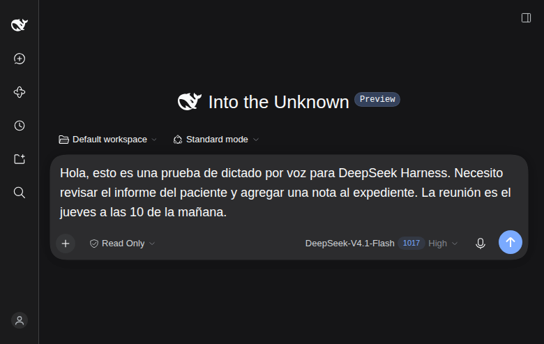

# DSH Voice prompter

Plugin de [DeepSeek Harness](https://github.com/deepseek-ai/deepseek-harness) que
añade un micrófono al compositor del chat: hablas, el texto aparece **en tu
prompt**, listo para editar. No envía el mensaje por ti.

Tiene dos motores intercambiables:

| Modo | Audio | Texto | Latencia medida |
| --- | --- | --- | --- |
| **Local + DeepSeek** (por defecto) | Se queda en tu equipo. Whisper lo transcribe. | La transcripción se envía a DeepSeek V4 Flash solo para corregirla. | ~4,6 s |
| **Gemini** | Se envía a Google. | No sale de Gemini. | ~1,6 s |

DeepSeek V4 Flash **no puede oír audio**: su API declara `input_modalities:
["text", "image"]`, no tiene endpoint de transcripción y rechaza `input_audio`.
Por eso el modo local usa Whisper para oír y DeepSeek solo para pulir el texto.



## Qué hace

- Botón de micrófono entre el selector de modelo y **Enviar**.
- Barra de grabación con nivel de audio, **Cancelar** y **Detener y transcribir**.
- La transcripción se inserta en la posición del cursor que había al empezar.
  Si el borrador cambió mientras hablabas, el texto no se pierde: queda un botón
  **Insertar texto** junto al micrófono.
- Panel de ajustes en **Plugins → Voice dictation**: motor, idioma, dispositivo
  de entrada y nivel en vivo del micrófono.
- Preparación del modelo local con progreso de descarga y verificación SHA-256.
- Estados visibles para permiso denegado, micrófono ocupado, silencio, error de
  red, modelo ausente, clave inválida y grabación demasiado larga.

## Instalación

Desde una copia de este directorio:

```sh
dsh plugin --profile web add /ruta/a/voz-dsh
```

El comando instala el paquete en el perfil `web`, lo enlaza y selecciona el
bundle «DSH Voice prompter». Después:

1. Nada que enlazar: el plugin **encuentra solo** el runtime `sherpa-onnx-node`
   de la instalación de DSH, aunque reinstales o actualices el paquete. No
   duplica los ~100 MB; si algún día corre en un entorno donde no lo encuentra,
   `node scripts/link-runtime.mjs` sigue disponible como plan B.

2. Descarga el modelo de Whisper la primera vez. Al pulsar el micrófono, DSH
   abre el asistente; también puedes ir a **Plugins → Voice dictation →
   Download and prepare**. Son ~104 MB y se guardan en
   `~/.dsh/speech-to-text/whisper-tiny`.

3. Para el modo **Local + DeepSeek** no hay que configurar nada más: el plugin
   lee la clave que DSH ya tiene en `~/.dsh/.credentials.yaml`
   (`DEEPSEEK_API_KEY`). También acepta `DEEPSEEK_API_KEY` en el entorno o un
   archivo `~/.dsh/voice-deepseek.key`. Si no encuentra clave, devuelve la
   transcripción local sin corregir.

4. El modo **Gemini** es opcional. Si lo eliges en los ajustes, necesita su
   clave en `~/.dsh/voice-gemini.key` (o `GEMINI_API_KEY`).

5. Reinicia `dsh web`. El Host monta el proveedor en caliente, pero el navegador
   solo descubre la mitad visual de un paquete instalado al arrancar. El comando
   imprime una URL nueva con otro token; la sesión queda guardada.

## Uso

1. Pulsa el micrófono.
2. La primera vez, el navegador pide permiso para usar el micrófono.
3. Habla. La onda muestra el nivel; el botón cuadrado detiene y transcribe.
4. Revisa el texto en el compositor y edítalo como cualquier prompt.

Atajos y detalles:

- **Escape** o **Cancelar** descartan la grabación sin insertar nada.
- El texto nunca se envía solo.
- Límites: 120 segundos y 4 MiB por grabación.
- El idioma por defecto es español; puedes cambiarlo en los ajustes.
- En el modo local, la primera transcripción carga el modelo en un proceso
  aparte (~2 s adicionales); las siguientes reutilizan el proceso.

## Configuración

La capa del bundle está en [`cordis.patch.yml`](cordis.patch.yml). Los valores
más útiles:

| Ajuste | Valor por defecto | Dónde |
| --- | --- | --- |
| Motor por defecto | `whisper-dsv4` | `voz-speech`, `config.defaultProvider` |
| Modelo local | `tiny` (o `base`) | `local.model` |
| Carpeta del modelo | `~/.dsh/speech-to-text/whisper-<modelo>` | `local.dataRoot` |
| Corrección DeepSeek | activada | `local.cleanup` |
| Modelo de corrección | `deepseek-flash` | `local.cleanupModel` |
| Hilos de CPU | 4 | `local.threads` |
| Modelo Gemini | `gemini-3.5-flash-lite` | `gemini.model` |
| Duración máxima | 120 s | `voz-api`, `config.maxDurationSeconds` |
| Tamaño máximo | 4 MiB | `voz-api`, `config.maxAudioBytes` |
| Normalización de nivel | activada | `local.normalize` |

`local.model` elige entre `tiny` (~104 MB, el más rápido) y `base` (~161 MB,
~1,7× más lento y notablemente mejor con acentos y nombres propios). Cada modelo
vive en su propia carpeta, así que cambiar entre ellos no vuelve a descargar
nada. Los archivos se verifican por tamaño y SHA-256 igual que tiny.

`local.threads` merece un ajuste según la CPU. Medido con 10,5 s de audio en un
i7-6600U (2 núcleos físicos, 4 lógicos): 1 hilo → 1046 ms, **2 hilos → 915 ms**,
3 hilos → 949 ms, 4 hilos → 1131 ms. En portátiles de 2 núcleos, `threads: 2` es
lo más rápido: con más hilos el decodificador compite consigo mismo y con el
navegador.

`local.normalize` ajusta el pico de la grabación a 0,9 antes de reconocer
(ganancia máxima 10×, y no toca el audio ya silencioso). Con el mismo audio al
8 % de nivel, activar la normalización devuelve el texto correcto donde sin ella
Whisper confundía palabras: es la defensa contra micrófonos flojos y contra el
DSP del navegador. El cliente, además, apaga `noiseSuppression` del micrófono
(está pensado para llamadas y se come consonantes) y graba a 128 kbps.

Para un dictado **totalmente offline** (sin enviar ni el texto a DeepSeek),
pon `local.cleanup: false`. Whisper seguirá transcribiendo en tu equipo; el
texto puede salir con errores en nombres propios.

## Privacidad

Modo local (por defecto):

- El audio se graba en el navegador, se convierte a WAV de 16 kHz y se reconoce
  en el Host de DSH. **No se escribe en disco ni se envía a nadie.**
- Solo la transcripción viaja a la API de DeepSeek para corregir puntuación,
  acentos y nombres propios. No se envía el prompt completo, ni archivos, ni
  historial de la sesión.
- Si no hay clave o la corrección falla, se usa el texto local tal cual.
- `local.cleanup: false` elimina también ese envío de texto.

Modo Gemini:

- El audio sale de tu equipo hacia Google; no se guarda en disco ni como
  adjunto. Solo el texto que decidas enviar forma parte de la conversación.
- Captura del selector con Gemini: [docs/ajustes-gemini.png](docs/ajustes-gemini.png).

En ambos modos, el micrófono requiere HTTPS o `127.0.0.1` y permiso del sistema.

## Rendimiento medido

Con un i7-6600U (4 hilos, sin GPU):

- 17,36 s de audio (14,36 s de voz + 3 s de pausa):
  Whisper tiny ~3,0 s + DeepSeek ~1,3 s = **~4,6 s** de extremo a extremo.
- Gemini 3.5 Flash Lite: **~1,6 s** para 11,7 s de audio.

Desglose local con `threads: 2` (audio de 4,7 s, proceso ya caliente):

- Whisper tiny solo: ~0,9 s por cada 10 s de audio.
- Corrección con `deepseek-flash`: **~+0,86 s** por dictado.
- El primer dictado tras arrancar paga además ~1 s de carga del modelo; el
  proceso de reconocimiento queda vivo entre dictados.

Whisper tiny es rápido pero puede confundir nombres propios («Deep Sleep
Harness»); la corrección de DeepSeek los arregla en la mayoría de los casos.
Si necesitas más precisión sin nube, se puede subir a Whisper base o small
(ver [`DESIGN.md`](DESIGN.md#10-futuro)).

## Nota sobre el bundle oficial «Voice input»

DSH también ofrece el bundle experimental **Voice input** con SenseVoice. No lo
actives a la vez que este plugin: ambos registran el mismo servicio de voz y el
mismo control del compositor. «DSH Voice prompter» ya incluye sus dos motores y su
propia UI; «Voice input» puede quedarse apagado.

## Desarrollo y pruebas

```sh
# 1. Genera WAV de prueba en español con la TTS de Gemini (requiere ffmpeg)
node test/tts-fixture.mjs

# 2. Prueba el modo local completo (Whisper + DeepSeek)
node test/local-smoke.mjs

# 3. Prueba solo Whisper, sin corrección
NO_CLEANUP=1 node test/local-smoke.mjs

# 4. Prueba el modo Gemini
node test/smoke.mjs

# 5. Prueba la UI completa con Chrome sin cabeza y micrófono falso
google-chrome --headless=new --remote-debugging-port=9222 \
  --user-data-dir=/tmp/dsh-chrome \
  --use-fake-ui-for-media-stream --use-fake-device-for-media-stream \
  --use-file-for-fake-audio-capture="$PWD/test/fixtures/dictado-es-pausa.wav" \
  about:blank &

RECORD_MS=15000 DSH_TOKEN=<token> node test/ui-check.mjs dictate
DSH_TOKEN=<token> node test/ui-check.mjs settings
```

Capturas de la verificación:

- [Dictado en el compositor](docs/dictado-local.png).
- [Ajustes con «Local + DeepSeek»](docs/ajustes-local.png).

## Estructura

```
voz-dsh/
├── lib/
│   ├── index.js          # registra los dos proveedores
│   ├── provider.js       # proveedor Gemini
│   ├── local.js          # Whisper local + preparación + DeepSeek
│   ├── whisper-child.js  # proceso hijo con sherpa-onnx
│   ├── wav.js            # lectura de WAV PCM16
│   └── client.js         # UI de micrófono (derivada de la oficial, ver NOTICE)
├── scripts/link-runtime.mjs
├── cordis.patch.yml      # filas del bundle
├── locale/               # títulos del bundle (en, es, zh)
├── test/                 # fixtures, smoke local/Gemini y prueba de UI
├── docs/                 # capturas
├── DESIGN.md             # decisiones y arquitectura
└── NOTICE                # atribución de la UI derivada
```

## Limitaciones

- Whisper tiny es el compromiso por velocidad; los nombres propios pueden
  necesitar la corrección de DeepSeek o el modo Gemini.
- La corrección con DeepSeek puede reescribir una palabra dudosa; el prompt le
  prohíbe cambiar el sentido, pero conviene revisar el texto antes de enviarlo.
- El modelo local y el runtime nativo suman ~104 MB + el runtime de DSH.
- Solo grabación completa: no hay texto parcial mientras hablas, ni envío
  automático, ni palabra de activación.
- El modo Gemini depende de la red y de una clave de Google.
- El modelo local es `sherpa-onnx-whisper-tiny` de k2-fsa (sherpa-onnx);
  Whisper es de OpenAI. Se descarga con revisión fijada y hashes SHA-256.

## Licencia

MIT. La UI de `lib/client.js` deriva del paquete oficial
`@deepseek-ai/dsh-experimental-client-ui-voice-input` (MIT, Copyright DeepSeek);
consulta [`NOTICE`](NOTICE).
